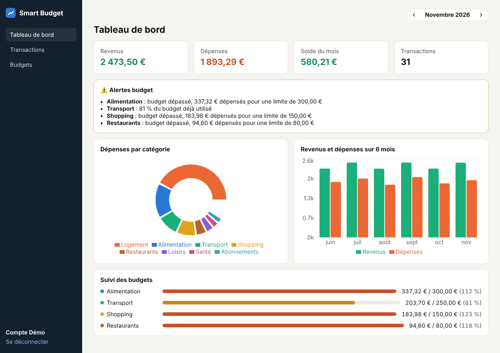
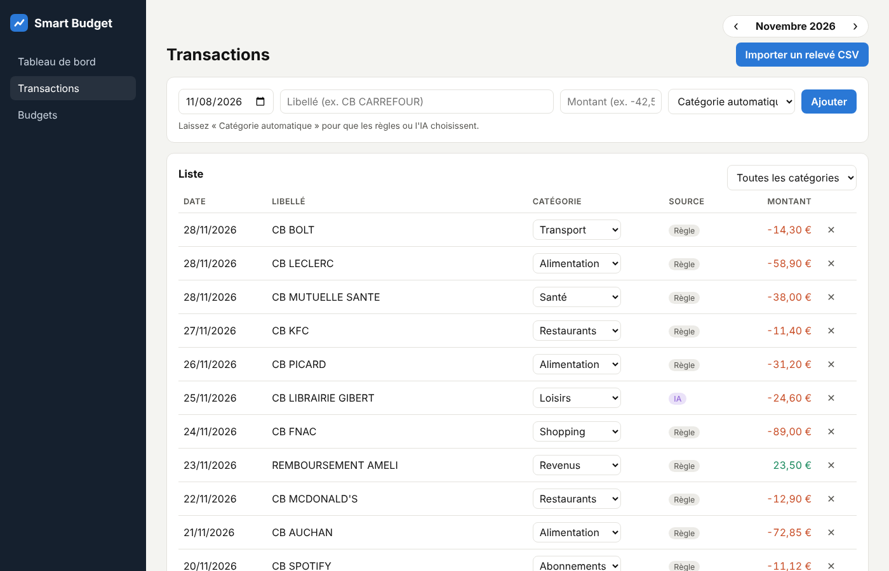
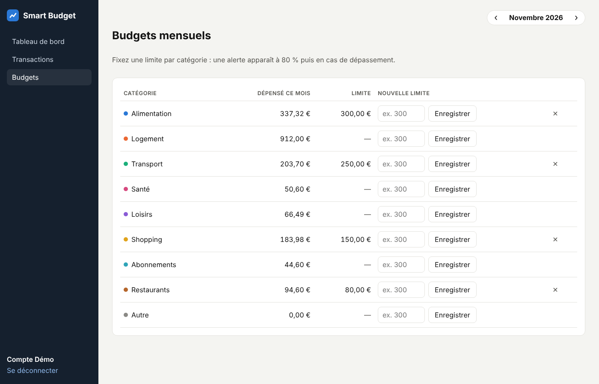
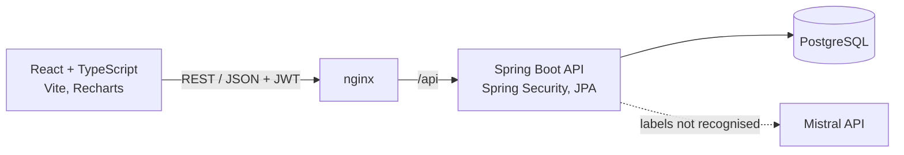

# 💶 Smart Budget – Full Stack budget app with AI categorization

> Import your bank statements, let rules and an LLM categorize every transaction, set monthly budgets and follow everything on a dashboard.




---

## ✨ Features

- 🔐 **Authentication** with Spring Security and **JWT** (stateless API, BCrypt-hashed passwords)
- 📥 **CSV import of bank statements**: French (`02/10/2026;CB CARREFOUR;-64,32`) and international formats, line-by-line error report
- 🤖 **Hybrid categorization**
  1. keyword rules (fast and free) for well-known merchants,
  2. a **Mistral LLM** for the labels the rules do not recognise,
  3. a default category if no API key is configured, so the app also works fully offline.
  The source of each category (rule, AI, manual) is shown, and the user can correct it in one click.
- 🎯 **Monthly budgets** per category with alerts at 80 % and when a budget is exceeded
- 📊 **Dashboard**: income, expenses, balance, spending by category, 6-month trend, budget progress
- 📄 **Swagger / OpenAPI** documentation of the REST API
- 🧪 **Automated tests**: unit tests (categorization, CSV parsing, budget alerts) and API integration tests with MockMvc
- 🐳 **Docker Compose** (PostgreSQL + API + front) and **CI with GitHub Actions**

| Transactions | Budgets |
|---|---|
|  |  |

---

## 🏗️ Architecture



**Backend** (`backend/`): layered by feature (`user`, `transaction`, `categorization`, `budget`, `dashboard`), each with its entity, repository, service, DTOs and controller.

| Method | Endpoint | Description |
|---|---|---|
| POST | `/api/auth/register` · `/api/auth/login` | Create an account / log in, returns a JWT |
| GET | `/api/auth/me` | Current user |
| GET | `/api/transactions?month=2026-10&category=` | Transactions of a month |
| POST · PUT · DELETE | `/api/transactions[/{id}]` | Create (auto-categorized if no category), update, delete |
| POST | `/api/transactions/import` | Import a CSV bank statement (multipart) |
| GET · PUT · DELETE | `/api/budgets[/{category}]` | List, create or update, delete budgets |
| GET | `/api/dashboard?month=2026-10` | KPIs, spending by category, trend, alerts |

Full documentation: **http://localhost:8080/swagger-ui.html** once the API is running.

**Frontend** (`frontend/`): React 18 + TypeScript, React Router, Recharts, a typed API client, responsive layout and dark mode.

---

## ▶️ Run it

### With Docker (recommended)

```bash
git clone https://github.com/Yassinech12/smart-budget.git
cd smart-budget
cp .env.example .env        # optional: add a JWT_SECRET and a MISTRAL_API_KEY
docker compose up --build
```

- App: **http://localhost:3000** · log in with the demo account **demo@smartbudget.dev / demo1234** (3 months of sample transactions and budgets)
- API documentation: **http://localhost:8080/swagger-ui.html**

### Without Docker

```bash
# API (Java 21 + Maven, PostgreSQL running locally with a "smartbudget" database)
cd backend
mvn spring-boot:run -Dspring-boot.run.profiles=demo

# Front (Node 20)
cd frontend
npm install
npm run dev                 # http://localhost:5173, /api is proxied to the API
```

A sample bank statement is available in [`sample-data/releve_bancaire_exemple.csv`](sample-data/releve_bancaire_exemple.csv).

### Tests

```bash
cd backend && mvn verify     # unit + integration tests (in-memory H2 database)
cd frontend && npm test      # Vitest
```

---

## 💡 Technical choices

- **Stateless JWT authentication**: no server session, the token is sent in the `Authorization` header, so CSRF protection is not needed.
- **Data isolation**: every query filters on the authenticated user, and an integration test checks that a user can not see another user's transactions.
- **Rules first, LLM second**: the LLM is only called for unknown labels, which keeps the app fast and the API cost low, and it keeps working without the LLM.
- **Amounts as `BigDecimal`**, never `double`, to avoid rounding errors on money.
- **Clean errors**: validation and business errors are returned as RFC 7807 *problem details*.

## 🗺️ Next steps

- Recurring transactions detection and monthly forecast
- Database migrations with Flyway
- Refresh tokens and account settings
- Deployment of a public demo

---

👤 **Yassine CHARIT** · [LinkedIn](https://www.linkedin.com/in/yassine-charit/) · [GitHub](https://github.com/Yassinech12)
